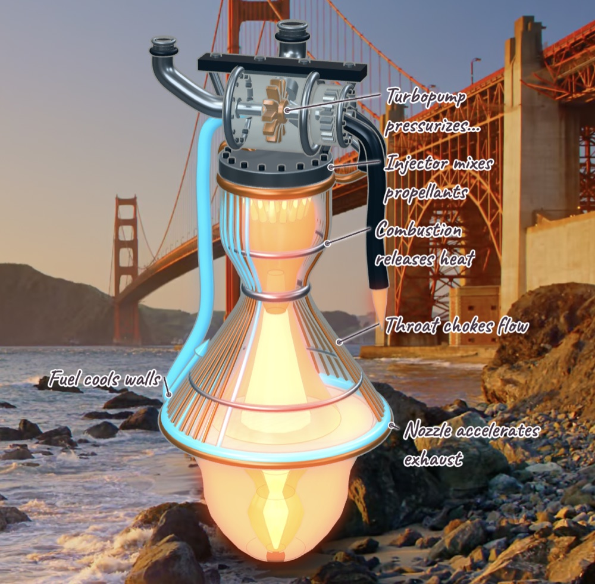

# HeyNimbo

An open-source AI buddy for your Mac that sees your screen, talks with you, draws on top of anything, and does real work. Hold **Control + Option**, ask a question, let go: it answers out loud while it circles, labels and sketches on your screen, or builds a live 3D model you can turn around.

An open-source alternative to [Clicky](https://www.heyclicky.com). Bring your own model key or run a local model. There's no account, no server of ours and no subscription.

<p align="center"></p>

## What it does

- **Explains your screen.** Ask about the page, app or error in front of you. It answers by voice and points at the parts it's talking about: circles, arrows, highlights and handwritten notes, timed to its speech.
- **Knows what you're pointing at.** While holding Control + Option, circle or underline something with the pointer and ask "what's this?". It answers about that spot, using a sharper close-up of it, and the pen trail shows what you marked. Just moving the pointer onto something works too.
- **Draws to explain.** Diagrams, step-by-step cards and sketches appear on screen in a handwritten style, drawn while it talks.
- **Builds 3D models.** Ask how an engine, a heart or a reactor works and you get a labelled, animated 3D model floating on your screen. Drag to turn it; it can cut the model open to show what's inside. Once built, the model looks at its own render and polishes it.
- **Does real work.** It can search the web, read pages, read and edit files and run commands, in the same conversation. Anything risky waits for your OK first (see [Safety](#safety)).
- **Works with your models.** OpenAI, your ChatGPT plan, Anthropic, Google Gemini, DeepSeek, OpenRouter, or any OpenAI-compatible endpoint such as Ollama or LM Studio.
- **Keeps things on your Mac.** Conversations, settings and keys stay in a local folder. Screenshots go only to the model provider you chose, and only when you ask something.

## Requirements

- macOS 14 or later on Apple Silicon
- [Node.js](https://nodejs.org) 24+ and [pnpm](https://pnpm.io) 10 (`corepack enable`)
- [Rust](https://rustup.rs) (stable) and Xcode Command Line Tools (`xcode-select --install`)
- A key for at least one model provider, a ChatGPT plan, or a local model

## Build and run

```sh
git clone https://github.com/GausPeerzade/HeyNimbo.git
cd HeyNimbo
pnpm install
pnpm --filter @heynimbo/native build   # the Rust module for shortcuts, capture and speech
pnpm signing:setup                     # once: lets macOS remember permissions across rebuilds
pnpm dist:mac
```

The app is built at `apps/desktop/dist/mac-arm64/HeyNimbo.app`. Move it to `/Applications` and open it.

`pnpm signing:setup` creates a self-signed certificate in its own keychain file, `~/Library/Keychains/heynimbo-local-signing.keychain-db`, and signs every build with it. Without it, each new build looks like a different app to macOS, which then asks for permissions again. The build is not notarized, so it is meant for your own Mac.

## First run

1. HeyNimbo lives in the menu bar; there's no Dock icon. The first window asks you to pick a provider and paste a key, or sign in with ChatGPT.
2. Hold **Control + Option**, speak, and let go. Press again to interrupt. While holding, circle or underline anything to ask about it. You can also type questions in Home.
3. macOS asks for each permission the first time it is needed:

| Permission | Why |
|---|---|
| Input Monitoring | Notice Control + Option from any app |
| Microphone | Hear your question |
| Screen Recording | See the screen you're asking about |
| Speech Recognition | Only without an OpenAI key, to understand speech on your Mac. Turn it on with **Settings → Voice → Allow speech recognition**. |

Voice uses OpenAI's realtime speech when an OpenAI API key is saved, whatever model answers. Otherwise it uses the Mac's own speech recognition and voices, at no cost; that needs your language's on-device speech support, which Settings → Voice checks for you. Typed questions in Home always work, even without voice.

## Safety

The agent's limits are enforced in code, not in the prompt ([details](docs/agent.md)):

- Web search, reading web pages and reading files need no approval. Writing files outside `~/HeyNimbo` and running shell commands ask you first, once or for the rest of that conversation. A command you approve runs with your full access.
- File tools never open key stores (`.ssh`, `.env`, keychains, credential files) or HeyNimbo's own settings, history and keys.
- HeyNimbo's own windows are left out of every screenshot.

Settings, history and keys are kept in `~/Library/Application Support/HeyNimbo`. Keys sit in `credentials.json`, a plain file only your user can read, as in tools like OpenCode, and are sent only to the provider they belong to. Besides your answer provider, HeyNimbo connects only to OpenAI for voice (when an OpenAI key is saved), to [Exa](https://exa.ai) for web searches, and to the public pages the agent reads. There is no telemetry.

## Skills

HeyNimbo's agent runs on [Pi](https://github.com/badlogic/pi-mono)'s SDK and loads [Agent Skills](https://agentskills.io/specification) from `~/.agents/skills`, so skills you already use with Pi or other agents work here too.

## Development

```sh
pnpm dev                 # run from source with hot reload
pnpm typecheck
pnpm test                # TypeScript and Rust tests
```

When running from source, macOS asks for permissions on behalf of `Electron` (or your terminal) instead of HeyNimbo.

| Path | What it is |
|---|---|
| `apps/desktop` | The Electron app: menu bar, Home, the overlay on each display, the agent and voice |
| `crates/heynimbo-native` | Rust module for shortcuts, screen capture, permissions and on-device speech |
| `crates/heynimbo-gestures` | Detects modifier-key holds and taps |
| `docs/` | How the [agent](docs/agent.md), [providers](docs/providers.md), [voice](docs/voice.md) and [macOS build](docs/mac-app.md) work |

## Status

Early, and macOS only for now; Windows support is planned. Issues and pull requests are welcome.

## License

[MIT](LICENSE). Third-party notices are in [THIRD_PARTY_NOTICES.md](THIRD_PARTY_NOTICES.md).
